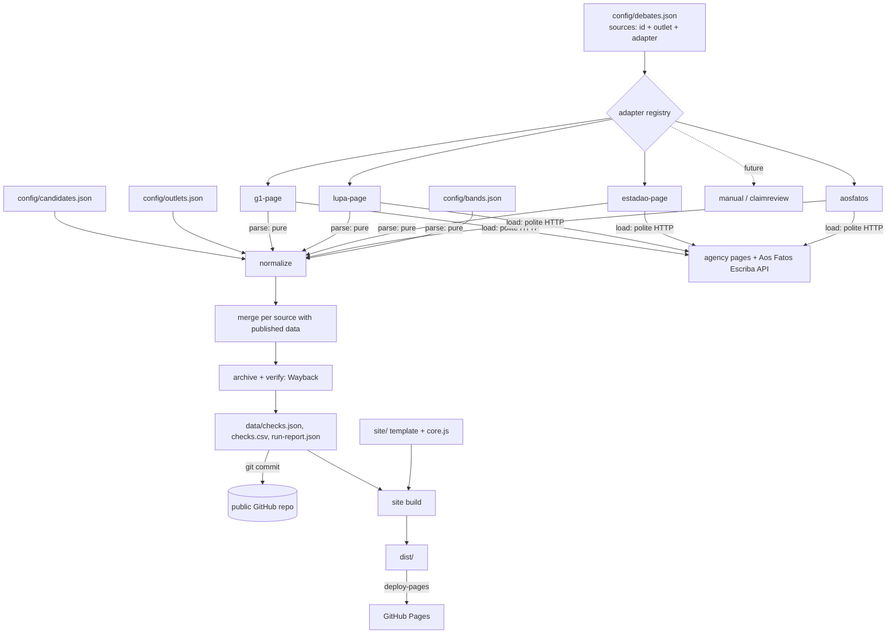

# Debate Archive Design

**Spec**: `.specs/features/debate-archive/spec.md`
**Context**: `.specs/features/debate-archive/context.md`
**Status**: Draft (revised after three reviews, 2026-10-24)

---

## Architecture Overview

No server and no database. A pipeline of small stages turns sources into JSON and CSV files, commits them, and publishes a static site built from the same files. Git history is the audit log.

Every input goes through a **source adapter**. An adapter knows how to load one kind of source and turn it into neutral `ParsedItem`s; nothing after it knows where an item came from. Adding a new kind of input (a new agency page format, ClaimReview feeds, or a future manual-entry format) means one adapter file, one registry line and one test. The MVP ships only agency-page adapters; manual entries are out of scope but must fit the same contract (see "Extension: manual sources").

Candidates, debates, sources, outlets and logos all live in `config/`. No candidate name, debate id or logo path is hardcoded in pipeline or site code.



Everything runs in one GitHub Actions workflow (`.github/workflows/update.yml`, see "Workflow"). Fallback when the runner is blocked by an agency (see Risks): the maintainer runs `pnpm ingest` locally and pushes; the `push` trigger builds and deploys. Same code, same outputs.

Cost: R$ 0/month on `*.github.io` (public repo: Actions and Pages are free). Optional domain about R$ 40/year.

---

## Stack

| Layer | Choice | Why |
| ----- | ------ | --- |
| Runtime | Node.js 24 LTS, TypeScript run directly by Node (type stripping) | No transpile step, no `tsx`. Code is limited to erasable syntax. `.nvmrc` pins the version; CI installs it with `actions/setup-node` (the runner's default Node is older). |
| Type checker | TypeScript 7 (native Go compiler, `typescript@7`, `tsc --noEmit`) | Only type-checks; Node runs the code. `typescript@7.0.2` is npm `latest` (published 2026-07-08). Nothing in the stack uses the TypeScript JS API, so the TS 7 API change does not affect us; confirm at install. |
| Package manager | pnpm | Already used by the maintainer. |
| HTML parsing | cheerio | No browser needed for any source. |
| robots.txt | robots-parser | Small, does one job (INGEST-07). Last release 2023; acceptable for a parser of a frozen format. |
| Config and file validation | zod | Validates `config/*.json` at startup; each adapter exports the schema for its own source fields. Errors name the bad field. |
| CSV | Hand-written RFC 4180 writer (about 15 lines) | One output, fixed columns; a library adds nothing. |
| Tests | vitest, always scoped by file or `-t` | Pure stages (parse, normalize, merge, core.js) are unit-tested. |
| UI checks | playwright-core driving an installed browser | Three checks only: 360 px, audit panel, clipboard fallback. CI uses `channel: 'chrome'` (Google Chrome is preinstalled on `ubuntu-latest`); locally `CHROMIUM_PATH=/usr/bin/chromium`. |
| Lint and format | Biome | One tool, one config, fast. |
| Site | Static HTML, CSS, one ES module (`app.js`) plus `core.js`; no bundler; self-hosted fonts | AD-003. The mock's Google Fonts link is replaced by local woff2 files (Inter, Inter Tight, OFL). |
| CI and hosting | GitHub Actions + GitHub Pages | AD-001. |
| Archive | Internet Archive Wayback Machine (availability API + Save Page Now 2) | Free, public, third party. |
| Licenses | AGPL-3.0 code, CC BY 4.0 dataset, third-party logos and fonts in `NOTICE` | Spec assumptions. |

Exact package and action versions are pinned at install time and recorded in `package.json` and the workflow, not here.

### TypeScript and module setup

- `package.json`: `"type": "module"`, `"engines": { "node": ">=24" }`, `"imports": { "#src/*": "./src/*" }` for subpath imports.
- `tsconfig.json`: `module: "nodenext"`, `target: "esnext"`, `noEmit`, `strict`, `erasableSyntaxOnly`, `verbatimModuleSyntax`, `allowImportingTsExtensions`.
- Imports always carry the `.ts` extension; type-only imports use `import type` (required by `verbatimModuleSyntax` under type stripping).
- CI runs `node src/ingest.ts --help` as a smoke test. vitest transforms TS on its own, so only this step proves Node can load the real module graph.

---

## Code Reuse Analysis

### Existing Components to Leverage

| Component | Location | How to Use |
| --------- | -------- | ---------- |
| Filter, URL state, ordering and scoreboard logic | `mocks/core.js` | Becomes `site/core.js` as an ES module, exported for tests. Covers SITE-03, SITE-04, SCORE-01..04, SHARE-01..02. Ordering switches from bare `localeCompare` to one shared `Intl.Collator('pt-BR')`. Candidate and debate lists come from the inlined config instead of constants. |
| Page layout, styles, motion, audit panel, prompt | `mocks/a-vitrine.html` | Split into `site/index.html` (markup + CSS) and `site/app.js` (render, FLIP list, rolling counts, sliding pill, audit panel). |
| Sprites and generator | `mocks/sprites/render.py`, `sprites.js`, `lula.svg`, `flavio.svg` | Copied to `site/sprites/`. The generator stays the source of truth; outputs are committed. |
| Party and broadcaster logos | `mocks/logos/` | Copied to `site/logos/`; paths referenced from `config/candidates.json` and `config/debates.json`. |
| Reference extractors | scratch review scripts (Python) | Not shipped. Their hand-checked counts become the golden test expectations below. |

### Integration Points

| System | Integration Method |
| ------ | ------------------ |
| Agency pages (g1, Lupa, Estadão, Aos Fatos Band) | HTTP GET of the HTML page, parsed with cheerio. Estadão is read from the page's embedded `Fusion.globalContent` JSON. |
| Aos Fatos Escriba API | `GET https://www.aosfatos.org/api/escriba/<escribaId>/` when the page payload contains `escribaId` (Globo debate). JSON, no auth. |
| Wayback Machine | Availability API to find a snapshot; Save Page Now 2 to request one; `id_` URLs to download original bytes for verification. |
| GitHub Pages | Static hosting of `dist/`. CORS `*` and Range requests let DuckDB-Wasm or any client read `checks.csv` later. |

---

## Components

### Configuration

**`config/candidates.json`**: who can be a speaker. Order on the site follows `number` ascending (ballot number), a fixed rule stated on the methodology page.

```json
[
  {
    "id": "lula",
    "name": "Luiz Inácio Lula da Silva",
    "short": "Lula",
    "party": "PT",
    "number": 13,
    "aliases": ["lula", "luiz inacio lula da silva"],
    "partyLogo": "logos/pt.svg",
    "sprite": "lula"
  },
  {
    "id": "flavio",
    "name": "Flávio Nantes Bolsonaro",
    "short": "Flávio",
    "party": "PL",
    "number": 22,
    "aliases": ["flavio", "flavio bolsonaro"],
    "partyLogo": "logos/pl.svg",
    "sprite": "flavio"
  }
]
```

**`config/outlets.json`**: who publishes checks. The record stores the outlet id; the site reads name and URL from here.

```json
{
  "aosfatos": { "name": "Aos Fatos", "type": "fact-checker", "url": "https://www.aosfatos.org" },
  "estadao": { "name": "Estadão Verifica", "type": "fact-checker", "url": "https://www.estadao.com.br/estadao-verifica/" },
  "g1": { "name": "g1 Fato ou Fake", "type": "fact-checker", "url": "https://g1.globo.com/fato-ou-fake/" },
  "lupa": { "name": "Lupa", "type": "fact-checker", "url": "https://www.agencialupa.org" }
}
```

`type` exists so a future press outlet can be told apart (and, if the user decides so, kept out of the scoreboard) without a schema change.

**`config/debates.json`**: debates and their sources (CONF-01). Every source has a stable `id`; records, the run report and the merge all key on it.

```json
{
  "debates": [
    {
      "id": "band-2026-10-18",
      "broadcaster": { "name": "Band", "logo": "logos/band.png" },
      "date": "2026-10-18",
      "round": 2,
      "candidates": ["lula", "flavio"],
      "sources": [
        { "id": "g1-band-2026-10-18", "outlet": "g1", "adapter": "g1-page", "url": "https://g1.globo.com/..." },
        { "id": "lupa-band-2026-10-18", "outlet": "lupa", "adapter": "lupa-page", "url": "https://www.agencialupa.org/..." },
        { "id": "aosfatos-band-2026-10-18", "outlet": "aosfatos", "adapter": "aosfatos", "url": "https://www.aosfatos.org/..." },
        { "id": "estadao-band-2026-10-18", "outlet": "estadao", "adapter": "estadao-page", "url": "https://www.estadao.com.br/..." }
      ]
    }
  ]
}
```

A source whose `adapter` is not in the registry fails and is named in the run report (CONF-02). The config loader validates each source with its adapter's `configSchema`.

**`config/bands.json`**: the public label-to-band table (DATA-03), keyed by outlet. Each entry keeps the label verbatim, its band and the URL where the outlet defines it (filled with observed URLs during implementation; `null` when the outlet publishes no definition).

Matching key: Unicode NFD, diacritics removed, lowercase, then every character outside `a-z` removed. So `#NÃOÉBEMASSIM` → `naoebemassim`, `#/FATO` → `fato` (typo observed on g1 Globo), `é subestimado` → `esubestimado`, `está subestimado` → `estasubestimado`. The record keeps the label verbatim. Only labels observed on real pages go in. A label missing from the table is published as `sem faixa`, listed in the run report, and fails the final workflow step so the maintainer is notified (see Workflow).

Initial table, all 21 labels observed 2026-10-24 (counts are Band / Globo):

| Outlet | Label (verbatim) | Band | Count |
| ------ | ---------------- | ---- | ----- |
| g1 | #FATO | verdadeiro | 16 / 11 (one written `#/FATO`) |
| g1 | #NÃOÉBEMASSIM | impreciso | 9 / 7 |
| g1 | #FAKE | falso | 12 / 2 |
| Lupa | VERDADEIRO | verdadeiro | 11 / 13 |
| Lupa | EXAGERADO | impreciso | 6 / 6 |
| Lupa | SUBESTIMADO | impreciso | 2 / 2 |
| Lupa | FALTA CONTEXTO | impreciso | 7 / 11 |
| Lupa | FALSO | falso | 11 / 8 |
| Lupa | INSUSTENTÁVEL | sem faixa | 4 / 3 |
| Aos Fatos | verdadeiro | verdadeiro | 18 / 20 |
| Aos Fatos | não é bem assim | impreciso | 15 / 9 |
| Aos Fatos | falso | falso | 16 / 8 |
| Estadão | é verdadeiro | verdadeiro | 9 / 12 |
| Estadão | é enganoso | impreciso | 7 / 5 |
| Estadão | é impreciso | impreciso | 1 / 4 |
| Estadão | falta contexto | impreciso | 5 / 9 |
| Estadão | é exagerado | impreciso | 3 / 1 |
| Estadão | é subestimado | impreciso | 0 / 1 |
| Estadão | está subestimado | impreciso | 1 / 0 |
| Estadão | é falso | falso | 2 / 4 |
| Estadão | é inconclusivo | sem faixa | 0 / 1 |

Totals: g1 37 / 20, Lupa 41 / 43, Aos Fatos 49 / 37, Estadão 28 / 37; 292 checks.

- `é enganoso` → impreciso: Estadão uses `é falso` as a separate, stronger label on the same pages. User confirmed 2026-10-24.
- `FALTA CONTEXTO` (Lupa) → impreciso: same meaning as Estadão `falta contexto` and Aos Fatos `não é bem assim`. User confirmed 2026-10-24.
- `INSUSTENTÁVEL` and `é inconclusivo` mean "no data to decide", so they get no band.

Because a band choice moves the scoreboard unevenly (FALTA CONTEXTO is 13 Flávio / 5 Lula; INSUSTENTÁVEL 6 / 1; é enganoso 6 / 4), the methodology page shows a label × candidate count table generated from the data, next to the mapping. The `sem faixa` row is always shown in scoreboards, even at zero.

### Adapter contract and registry (`src/adapters/`)

```typescript
interface Doc {
  url: string // where the bytes came from (page, API endpoint, or a repo file URL)
  body: string
  sha256: string
  fetchedAt: string
}

interface ParsedItem {
  key: string | null // the source's own stable item id; null when the source has none
  doc: number // index of the doc in load()'s result that holds this item (the evidence)
  pos: number // 1-based order inside the source
  anchor: string | null // fragment that scrolls to the item on the outlet page, if any
  url?: string // per-item URL when it differs from the doc URL (future manual / feeds)
  speakerRaw: string
  quote: string
  label: string // verbatim display text
  explanation: string
}

interface Adapter {
  kind: string // "lupa-page", "aosfatos", later "manual", "claimreview"
  version: number // bumped on any output change; stored as "<kind>@<version>"
  configSchema: ZodType // source fields this adapter needs (url, or file for manual)
  load(source: SourceConfig, io: Io): Promise<Doc[]> // all I/O lives here
  parse(docs: Doc[]): ParsedItem[] // pure: same docs, same items (DATA-04)
}

interface Io {
  get(url: string): Promise<Doc> // the polite HTTP client below
  readFile(path: string): Promise<Doc> // repo files, for a future manual adapter
}
```

- `src/adapters/index.ts` exports `registry: Map<string, Adapter>`. That map is the whole factory: no plugin loader, no DI container.
- `parse` never touches the network or the clock, so unit tests run it on hand-written docs.
- `parse` must also accept only the evidence doc (the archived copy) and yield the same items for it. The archiver relies on this to verify snapshots.

### Polite HTTP client (`src/io/http.ts`)

- **Purpose**: The only network path to agency sites (INGEST-07).
- **Behavior**: Node `fetch` with `AbortSignal.timeout(30_000)`; user agent `debates-checados/<version> (+<repo URL>)`; at most one request per domain every 5 s (in-memory per-domain clock); `robots.txt` checked once per domain with `robots-parser` before any request, disallowed URLs refused. Non-200 throws a typed error the pipeline turns into a failed source.
- **Test**: Estadão's robots.txt has `Disallow: /estadao` and `Allow: /estadao-verifica`; a unit test pins that the debate URLs are allowed (longest-match rule).

### MVP adapters

All four observed on the fixture pages 2026-10-24. Counts are the golden expectations (Band / Globo).

| Kind | Items from | `key` | Speaker | Quote | Label | Explanation |
| ---- | ---------- | ----- | ------- | ----- | ----- | ----------- |
| `g1-page` | Each `blockquote.content-blockquote` inside a `div#chunk-*` (35 / 19 quotes); one item per verdict (37 / 20) | `chunk-*` id of the quote block, plus `.2` for a second verdict | Section intertitle `.content-intertitle h2` (`FLÁVIO BOLSONARO (PL)`, `LULA (PT)`) | Blockquote text | Tag in the "Veja por que a primeira/segunda… é #X:" paragraphs when present, otherwise in the single "A declaração… é #X." paragraph | Paragraphs after the label, up to the next label or quote |
| `lupa-page` | Each `div.wp-block-seox-seox-quotes` followed by a label block (41 / 43) | none | `<cite>` inside the quote (`Luiz Inácio Lula da Silva (PT), presidente e candidato…`) | Blockquote text without `<cite>` | `div.block-text` of the following `data-block-id` block | Paragraphs after the label, up to the next `hr` |
| `estadao-page` | `Fusion.globalContent.content_elements` (embedded JSON): an element starting `O que <Nome> disse:` or `O que disse <Nome>:` immediately followed by one starting `O Estadão Verifica (checou\|investigou) e concluiu que:` (28 / 37) | `_id` of the "O que" element | The name inside the "O que" prefix | Text after the prefix's `:` | Text between `concluiu que:` and the first `.` | Rest of the conclusion element after that `.` |
| `aosfatos`, server HTML | `<p id="<uuid>">` followed by `<blockquote data-stamp>` (49 / n.a.) | the `<p>` uuid | Nearest preceding transcript speaker heading (`Lula`, `Flávio Bolsonaro`) | Text of the `<p id>` | Display text of the stamp code | First `<p>` of the blockquote |
| `aosfatos`, Escriba API | `comment` nodes with a `selo` prop (n.a. / 37 of 61) | the comment `id` (uuid) | Block `speaker` (`Lula`, `Flávio Bolsonaro`), inherited by following blocks without one | Comment text | Prop with `key: "selo"` mapped to display text | First paragraph of `data.content` |

Rules shared by adapters:

- Quotes are whitespace-collapsed and stripped of stray quote marks at the edges (`"`, `“`, `”`). A quote that ends up shorter than 10 characters fails the item and is reported (the old prototype produced `")"` and `": que Flávio…"`).
- g1 traps observed: an explanation that mentions "selo de #FAKE" is not a label (labels only come from the two paragraph shapes above); a double verdict also has a summary paragraph with both tags, which is skipped in favor of the "Veja por que" paragraphs; content after "Veja também" is ignored.
- Aos Fatos: if the page payload has `escribaId`, the adapter loads and parses the API (Globo page); otherwise it reads the server HTML (Band page). The "Veja o que checamos" index is not used (it lags: 29 anchors vs 37 stamps on Globo). Comments without `selo` are treated as checks not yet rated and skipped; their count goes in the run report so a later rating shows up as new items. Stamp code to display text comes from Aos Fatos' CSS `::after` content: `verdadeiro` → "verdadeiro", `falso` → "falso", `nao_e_bem_assim` → "não é bem assim". An unknown code is published verbatim and reported.

### Extension: manual sources (not in MVP)

Shape the contract already supports, so adding it later is one adapter plus a decision on eligibility rules:

- Source config: `{ "id": "metropoles-band-2026-10-18", "outlet": "metropoles", "adapter": "manual", "file": "sources/manual/band-2026-10-18/metropoles.json" }`. The adapter's `configSchema` requires `file` instead of `url`.
- `load` reads the repo file through `io.readFile` and returns it as one `Doc` (its `url` is the file's GitHub URL, so provenance points to the commit that added it).
- `parse` validates the file with a zod schema and maps each entry to a `ParsedItem` with its own `url` and `key`.
- Archive, merge, IDs, history and the site work unchanged.
- Open before building it: which outlets qualify, whether items without an explicit verdict are allowed, and whether press outlets count in the scoreboard. These are impartiality decisions for the user, not technical ones.

### Normalizer (`src/pipeline/normalize.ts`)

- `nameKey(raw)`: cut at the first `,`, drop any `(…)` group, NFD, remove diacritics, lowercase, collapse whitespace, trim. `FLÁVIO BOLSONARO (PL)` → `flavio bolsonaro`; `Luiz Inácio Lula da Silva (PT), presidente e candidato` → `luiz inacio lula da silva`.
- `resolveSpeaker(raw, candidates): string | null`: exact match of `nameKey(raw)` against the debate's candidates' aliases. `null` excludes the item and reports it with its source URL (INGEST-05).
- `labelKey(label)` and `bandFor(outlet, label): Band`: see `config/bands.json`.
- `excerpt(text)`: whitespace-collapsed, cut at the last word boundary before 280 chars plus "…".
- `quoteKey(quote)`: NFD, diacritics removed, lowercase, punctuation removed, whitespace collapsed. Used for exact matching of keyless items.
- `tokens(quote)`: set of `quoteKey` words with 3 or more letters. Used for fuzzy matching.

### Record IDs

An ID is assigned once, when a record is first seen, and never recomputed (INGEST-04):

```
id = first 12 hex chars of SHA-256("<sourceId>|<key>")         when the source gives a key
id = first 12 hex chars of SHA-256("<sourceId>|<quoteKey>#<n>") when it does not (Lupa)
```

`n` is 1 for the first occurrence of a quote in the source and grows for identical quotes later in the same page (the duplicate edge case; the duplicate is reported).

Three of the four outlets give a stable key: g1 chunk ids were identical across two fetches on 2026-10-24, Estadão `_id`s are unique per element (103 / 103 on Band, 82 / 82 on Globo), and Aos Fatos uses uuids. For Lupa the merge has to recognize an item whose quote was edited (next section).

### Merger (`src/pipeline/merge.ts`)

`merge(previous: CheckRecord[], fresh: SourceResult[], ctx): { records, events }`, run per source.

1. **Failed source** (load error, non-200, timeout, zero items): its previous records pass through unchanged (INGEST-06).
2. **Partial parse**: if a successful source yields fewer than 80% of its previously published, not-missing records (and it had at least 5), the source is treated as failed with reason `partial`. A maintainer accepts a real drop with `pnpm ingest --accept-drop=<sourceId>` (also a `workflow_dispatch` input).
3. **Matching** fresh items to previous records of the same source, in order:
   1. same `key`;
   2. keyless only: same `quoteKey`;
   3. keyless only: same speaker and token Jaccard ≥ 0.6, best score first, each previous record used once. The highest Jaccard between two distinct items in the sample data is 0.35, so 0.6 leaves margin;
   4. `config/id-links.json` (`{ "<sourceId>": { "<quoteKey>": "<existing id>" } }`): manual override for a match the rules miss, reviewed in a public commit.
   Unmatched fresh items are new records with a new ID.
4. **Matched record**: `label`, `quote` and `speaker` changes push the previous value to `history` with the detection date (HIST-01). `pos`, `anchor`, `excerpt` and `url` are overwritten without history. If nothing compared changed, the previous record is kept byte-for-byte, including `evidence`.
5. **Previous record not matched** in a successful source: kept with `missingSince` set (HIST-02). It is cleared if the item comes back.
6. **Band**: recomputed for every record on every run from the current `config/bands.json`, including records passed through from failed sources, so a table edit and its effect land in the same commit.
7. Output sorted by debate date desc, outlet name (pt-BR collation), `pos`; JSON written with stable key order.

### Archiver (`src/pipeline/archive.ts`)

Runs for every record whose content changed in this run and for every record whose `evidence.archiveUrl` is still `null` (so DATA-06 retries each run until it succeeds). Work is grouped by evidence doc, so one capture serves all items of a page.

1. Availability API for the evidence URL. A candidate snapshot must have `closest.status == "200"` (rejects Cloudflare challenge pages). Its age does not matter: step 3 decides whether it holds the records.
2. **Verify**: download the snapshot's original bytes (`https://web.archive.org/web/<timestamp>id_/<url>`), compute SHA-256, run the adapter's `parse` on them, and check that every record of that doc being archived is present with the same key or quote, speaker and label. Only then set `evidence.archiveUrl` and `evidence.sha256`. An older snapshot that already has the item verifies; one taken before the item was added does not.
3. If no snapshot verifies, request a capture with Save Page Now 2 (`POST https://web.archive.org/save` with `if_not_archived_within`, authenticated with the `IA_S3_ACCESS` / `IA_S3_SECRET` secrets), poll the job status until done or 3 minutes pass, then run step 2 on the new snapshot. Captures are spaced at least 20 s apart (SPN2 allows only a few captures per minute). Without secrets this step is skipped and the run report says so.
4. Any failure leaves both `null`, reported in the run report, retried next run.

The secrets come from a free archive.org account (S3-like keys page). Without them only pre-existing snapshots can verify, so most records published after the debates would ship without an archived copy; creating the account and saving the two secrets is a setup step before the first CI run.

For the Aos Fatos Globo debate the evidence doc is the Escriba API JSON, not the page (the page has no checks in its HTML), so that is the URL archived and verified.

This makes the hash checkable by anyone: download the `id_` copy, hash it, run the parser at the recorded version, compare. The hash of the live fetch is not stored, because g1 and Estadão serve different bytes on every request (ads, tokens).

### Run report (`data/run-report.json`)

Stable content only, so it changes when something real changes. Per source id: status (`ok`, `failed`, `partial`), failure reason, adapter kind and version, item count, excluded items (with source URL and reason), duplicates, unmapped labels, Aos Fatos unrated comment count, and records still waiting for an archive (INGEST-09). No timestamps, no per-run hashes.

Per-run details (HTTP status and SHA-256 of each fetch, timings, archive attempts) go to the workflow's job summary and an uploaded `run-log.json` artifact, kept by Actions for 90 days.

### Workflow (`.github/workflows/update.yml`)

```yaml
on:
  schedule: [{ cron: '17 */6 * * *' }]
  workflow_dispatch:
    inputs:
      accept_drop: { description: 'Source id allowed to shrink by more than 20%', required: false }
  push: { branches: [main] }

permissions: { contents: write, pages: write, id-token: write }
concurrency: { group: update, cancel-in-progress: false }

jobs:
  update:
    runs-on: ubuntu-latest
    environment: { name: github-pages, url: '${{ steps.deploy.outputs.page_url }}' }
    steps:
      - uses: actions/checkout
      - uses: pnpm/action-setup
      - uses: actions/setup-node            # node-version-file: .nvmrc, cache: pnpm
      - run: pnpm install --frozen-lockfile
      - run: pnpm typecheck && pnpm lint && pnpm test:unit
      - run: node src/ingest.ts --help       # Node loads the real module graph
      - run: pnpm ingest --accept-drop="${{ inputs.accept_drop }}"
        env: { IA_S3_ACCESS: '${{ secrets.IA_S3_ACCESS }}', IA_S3_SECRET: '${{ secrets.IA_S3_SECRET }}' }
      - run: |                               # commit only if data/ changed
          git add data
          git diff --cached --quiet || { git commit -m "chore(data): Update checks"; git pull --rebase; git push; }
      - run: pnpm build
      - uses: actions/configure-pages
      - uses: actions/upload-pages-artifact  # path: dist
      - id: deploy
        uses: actions/deploy-pages
      - uses: actions/upload-artifact        # run-log.json
      - run: pnpm check:labels               # fails the run if any label is unmapped
```

- Deploy runs in the same job because commits pushed with `GITHUB_TOKEN` do not trigger other workflows. For the same reason the bot's commit cannot loop, so there is no `paths-ignore`: a maintainer's local push of `data/` must still deploy.
- `concurrency` keeps a scheduled run and a push from committing at the same time; `git pull --rebase` covers a push that landed during the run.
- `pnpm test:unit` runs the unit directory only on CI; golden tests (network, `.cache/`) and Playwright checks run locally or on `workflow_dispatch`.
- One-time repository setup: Pages source set to "GitHub Actions"; no branch protection on `main` for the bot (or an allowance for `github-actions[bot]`).
- `check:labels` runs last so data and site are already published with the label as `sem faixa`; the red run is the notification.

### Site build (`src/site/build.ts`)

- Copies `site/` and `data/` into `dist/`; inlines `checks.json`, candidates, outlets and debates into `index.html` as `<script type="application/json">`; pre-renders the list with the same `itemHtml()` string function the browser uses, so the page has content without JavaScript. `app.js` adopts the pre-rendered `<li data-id>` nodes.
- Pages: `index.html` and `metodologia.html` (DATA-07). The methodology page renders the band table from `config/bands.json` and the label × candidate count table from the data, so page, file and data can't drift. It also states the candidate order rule (ballot number) and the credits (AUDIT-08).
- Every asset (fonts, logos, sprites) is served from the site's own origin (SITE-07).

### Site behavior (`site/core.js`, `site/app.js`)

- **Filters**: debate, agency, candidate and band, each single-valued ("Todos" or one value). Agency single-select matches the mock and makes the per-agency scoreboard the only non-general state (SCORE-01, SCORE-02).
- **Removed items**: records with `missingSince` are left out of every scoreboard. The list hides them by default; a "Mostrar removidos (N)" control, shown only when N > 0, includes them, each tagged "não encontrado na fonte desde <data>" (HIST-02). URL state includes the toggle (SHARE-01).
- **Scoreboard**: candidates in ballot-number order; the four bands always listed, `sem faixa` included at zero (SCORE-01..04).
- **Empty state** (SITE-05): "Nenhuma checagem com esses filtros." plus a "Limpar filtros" button that resets every filter.
- **Audit panel** (AUDIT-01..05): a `<dialog>` opened by the inline link and by the fixed "Como auditar" button; focus moves into it and returns on close; "Copiar prompt" uses `navigator.clipboard.writeText` and, when unavailable or rejected, selects the prompt text in a read-only `<textarea>` and shows the fallback message.
- **Motion**: as in the mock (sliding pill, rolling numbers, wave bars, FLIP list), all off under `prefers-reduced-motion`.

---

## Data Models

```typescript
type Band = 'verdadeiro' | 'impreciso' | 'falso' | 'sem faixa'

interface CheckRecord {
  id: string // assigned once, see "Record IDs"
  sourceId: string // config/debates.json source id
  debate: string // e.g. "globo-2026-10-23"
  outlet: string // key in config/outlets.json
  key: string | null // the source's own item id, if any
  pos: number
  anchor: string | null
  speaker: string // candidate id from config/candidates.json
  quote: string
  label: string // verbatim, as displayed by the outlet
  band: Band
  excerpt: string // <= 280 chars + "…"
  url: string // where a reader checks it: outlet page (+ #anchor) or the item's own URL
  adapter: string // "<kind>@<version>" that produced the current content
  evidence: {
    url: string // doc the item was parsed from (page or API)
    fetchedAt: string // fetch that last changed this record
    archiveUrl: string | null // Wayback id_ URL, verified
    sha256: string | null // of the archived original bytes
  }
  missingSince?: string // HIST-02
  history?: { label?: string; quote?: string; speaker?: string; until: string }[] // HIST-01
}
```

CSV (`data/checks.csv`): one row per record, `evidence` flattened to `evidence_url`, `fetched_at`, `archive_url`, `sha256`; `history` as a JSON text column. UTF-8, RFC 4180 quoting.

`outlet` instead of `agency`: the field name is public (CSV header, JSON key) and expensive to change later; a future press outlet is not an agency.

---

## Error Handling Strategy

| Error Scenario | Handling | User Impact |
| -------------- | -------- | ----------- |
| Page non-200, timeout, robots disallow | Source marked failed; previous records kept | None; the run report shows the failure |
| Adapter returns zero items | Same as a failed source | None |
| Adapter returns < 80% of previous records | Source marked `partial`, previous records kept until `--accept-drop` | None |
| Unknown adapter kind in config | Source fails, named in report | None |
| Invalid config file | zod error naming the field; run aborts before any fetch | None; workflow fails, last deploy stays |
| Unknown label | Published with `sem faixa`, reported, final workflow step fails | Item shows the verbatim label |
| Speaker not resolved | Item excluded, reported with URL | Missing until the alias table is fixed |
| Quote shorter than 10 chars after cleanup | Item excluded, reported | Missing until the adapter is fixed |
| Wayback unavailable, rate limited, or snapshot does not verify | `archiveUrl` and `sha256` stay `null`, reported, retried next run | No "cópia arquivada" link on that item yet |
| Whole run throws | Workflow fails before commit; Pages keeps the last deploy | None |

---

## Risks & Concerns

| Concern | Location (file:line) | Impact | Mitigation |
| ------- | -------------------- | ------ | ---------- |
| Lupa is behind Cloudflare and may block GitHub runner IPs (not tested) | n/a (external) | Lupa records stop updating from CI | First task after the repo exists: run the workflow once. If blocked, INGEST-06 keeps old records and the maintainer runs `pnpm ingest` locally. |
| Lupa has no item id; a heavily rewritten quote can become a new record | `src/pipeline/merge.ts` | Old record marked missing, new one added | Jaccard match covers edits; `config/id-links.json` fixes the rest in a public commit. |
| Aos Fatos uses two formats (server HTML on Band, Escriba API on Globo) | n/a (external) | An adapter that knows one format silently drops a debate | Adapter handles both; golden tests cover both pages; zero items → failed source. |
| Agencies change their HTML | n/a (external) | Adapter yields nothing, garbage or fewer items | Zero-item and 80% guards; per-page expected counts in golden tests; version bump on fix. |
| Raw agency HTML can't be committed (DATA-05), yet adapters need real fixtures | test setup | Tests would depend on live sites | Unit tests use small hand-written docs that copy the structure, not the text. Golden tests download pinned Wayback `id_` copies into a git-ignored `.cache/` and check the counts in the adapter table. |
| SPN2 behavior and limits come from its public docs, not from a run of ours | `src/pipeline/archive.ts` | Captures fail or get throttled | Spacing, polling timeout, null + retry; confirm the API doc at implementation. |
| No archive.org keys in the repo secrets | repository settings | New records ship without archived copy or hash, weakening the audit claim | Setup step before the first CI run (T22); run report lists every record waiting for a snapshot. |
| Band choices move the scoreboard unevenly between candidates | `config/bands.json` | Perceived bias | Label × candidate table on the methodology page; `sem faixa` always visible; both decisions user-confirmed and logged. |
| Mock code mixes render, state and motion in one inline script | `mocks/a-vitrine.html:268` | Hard to test once moved | Split into `core.js` (pure, tested) and `app.js` (DOM only). |
| Scheduled workflows stop after 60 days without repo activity | `.github/workflows/update.yml` | Updates stop | Acceptable: pages are static after the election. `workflow_dispatch` stays available. |
| Party and broadcaster logos are trademarks | `site/logos/` | Can't be relicensed with the code | Listed as third-party in `NOTICE`; used only to identify. |
| Manual sources reintroduce selection bias | future `manual` adapter | The site stops being "everything the outlet published" | Not in MVP; eligibility rules must be decided before the adapter ships (see Extension). |

---

## Tech Decisions

| Decision | Choice | Rationale |
| -------- | ------ | --------- |
| Input extensibility | Adapter interface + `Map` registry, per-adapter config schema | Covers new page formats, feeds and manual files with one file each; no plugin system needed for a handful of kinds. |
| Record identity | Source's own item id when it exists, ID frozen at first sight, fuzzy match for keyless sources | A hash of the quote changes when an agency fixes a typo; three of four sources already expose stable ids. |
| Estadão source | Embedded `Fusion.globalContent` JSON | Gives `_id` per element and separates prefix from text; HTML puts label and explanation in one paragraph. |
| Aos Fatos Globo source | Escriba JSON API | Its checks are not in the server HTML; the API is what the page itself loads, and `/api/` is not disallowed for generic agents in robots.txt. |
| Evidence hash | SHA-256 of the verified Wayback `id_` copy | The only bytes an outsider can download again; live bytes change per request on g1 and Estadão. |
| Run report | Stable fields in `data/`, per-run details in Actions | Keeps "a second run produces no diff" true. |
| Candidate order | Ballot number ascending | Objective, stated rule; no reading of preference in left/right placement. |
| Agency filter | Single select | Matches the mock; one per-agency scoreboard state. |
| Data files | JSON + CSV in git, no database | About 300 records, a few hundred KB; git gives free history and diffs. |
| Record field `outlet` | Instead of `agency` | Public schema; future sources are not all agencies. |
| TypeScript execution | Node type stripping, no build for the pipeline | One fewer tool; erasable-syntax rule enforced by `tsc` (`erasableSyntaxOnly`). |
